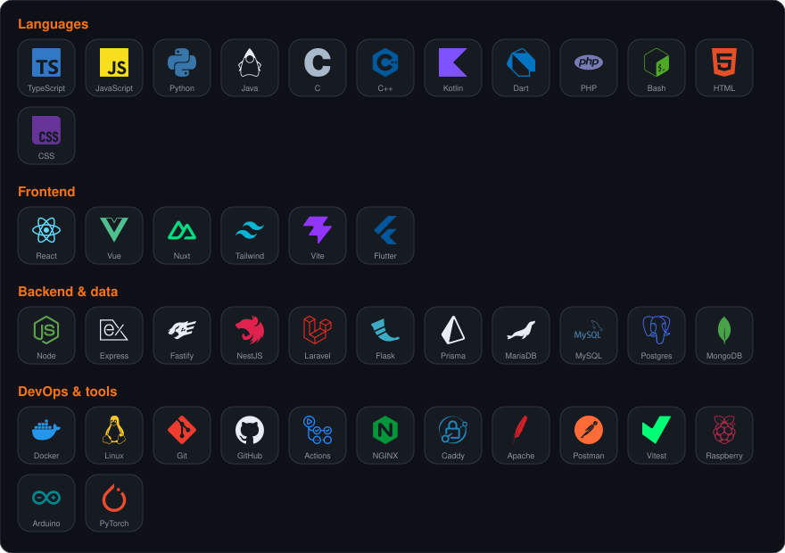
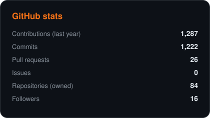
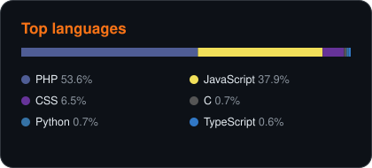
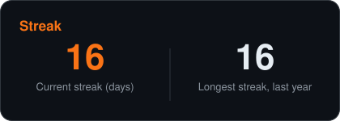
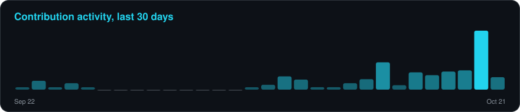

 

---

## 👋 About me

- 🎓 Computer science student (BUT Informatique, work-study programme), with a background at **42** (Piscine and common-core projects in C/C++).
- 🏋️ Building **[Rackup](https://rackup.fr)**, a free offline-first workout tracker, and running several other apps in production (see below).
- 🤖 I write Discord and Slack bots, web apps, mobile projects and small security tools.
- 🖥️ I host my projects on my own VPS: Docker, Caddy, MariaDB, monitored with Uptime Kuma, with a public [status page](https://status.picsou06.fr/status/picsou06).

---

## 🚢 In production

Projects running for real users on my own VPS (Docker, Caddy, MariaDB), monitored with Uptime Kuma.

| Project | What it really does | Stack | Link |
|---|---|---|---|
| 🏋️ **Rackup** | Workout tracker you can use at the gym even without network: log each set, see your last performance, records, progress curves and a rank per exercise from Iron to Unreal. Friends, rankings, group sessions with live progress, push notifications, French and English, and an MCP server so an AI assistant can plan your session. Free PWA for Android and iPhone | React 19 · Fastify · MariaDB · Web Push · MCP | [rackup.fr](https://rackup.fr) |
| 📚 **ENIV** | A lightweight school portal centred on the class homework diary: pupils add homework, everyone sees it in real time, each one ticks what is done, comments, attached documents (converted to PDF), AI-generated revision quizzes, class timetable, calendar subscriptions and share links. Installable PWA with an MCP server | Node.js · Express 5 · MariaDB · WebSocket · PWA · MCP | [eniv.fr](https://eniv.fr) |
| 💊 **Ecomed** | *Proof of concept.* Help for eco-responsible prescriptions: search or scan a medicine box, rank laboratories by the carbon score of production, and compare prescriptions. Uses the real French drug database (BDPM, real CIP13 codes); the carbon scores are estimates, not verified data | NestJS · Prisma · MariaDB · React + Vite PWA | [ecomed.picsou06.fr](https://ecomed.picsou06.fr) |
| 🐙 **Scubanion** | University team project (4 people): a Tamagotchi-like virtual pet whose health and progress depend on its owner's real physical activity: steps counted by the phone's pedometer, geolocated quests and a bonus when two users meet (Bluetooth). I host its API | Nuxt 4 · Capacitor (Android) · Laravel · MariaDB | [Scubatana/scubanion](https://github.com/Scubatana/scubanion) |
| 🤖 **SipChecker** | Slack bot for the 42 community that tracks members' hydration with emoji reactions, with `/sip` statistics, a daily report and about 13 interface languages | Node.js · Slack Bolt · MySQL | [SipChecker](https://github.com/Picsou06/SipChecker) |
| 🎓 **Discord bots** | **BUT2Useful** for my BUT2 class (SAE group projects with automatic roles and channels, moderation, leaderboards) and **CedrikBot**, a slash-command starter bot | Node.js · discord.js 14 · MySQL | [CedrikBot](https://github.com/Picsou06/cedrik2.0_bot_NSI) |
| 📡 **Status page** | Public live availability of all my services | Uptime Kuma | [status.picsou06.fr](https://status.picsou06.fr/status/picsou06) |

---|---|---|---|
| 🏋️ **Rackup** | Free, offline-first workout tracker (PWA): live stats, records, ranks from Iron to Unreal, friends, group sessions, push notifications, FR/EN, MCP server for AI assistants | React 19 · Fastify · MariaDB · Web Push | [rackup.fr](https://rackup.fr) |
| 📚 **ENIV** | A lightweight school portal (ENT) for a class: shared homework agenda, documents, quizzes, live updates | Node.js · WebSocket · MariaDB | [eniv.fr](https://eniv.fr) |
| 🩺 **Ecomed** | Web application with its own API and installable front end | NestJS · Prisma · React PWA | [ecomed.picsou06.fr](https://ecomed.picsou06.fr) |
| 🤿 **Scubanion** | Back end for a scuba-diving project (open source) | Laravel · Nginx · MariaDB | [Scubatana/scubanion](https://github.com/Scubatana/scubanion) |
| 🤖 **Discord & Slack bots** | CedrikBot and BUT2Useful (Discord, students' utilities), SipChecker (Slack, hydration stats) running 24/7 | Node.js · Docker | [SipChecker](https://github.com/Picsou06/SipChecker) · [CedrikBot](https://github.com/Picsou06/cedrik2.0_bot_NSI) |
| 📡 **Public status page** | Live availability of all my services | Uptime Kuma | [status.picsou06.fr](https://status.picsou06.fr/status/picsou06) |

---

## 🛠️ Tech stack

---

## 🚀 Featured projects

<table>
  <tr>
    <td width="50%"></td>
    <td width="50%"></td>
  </tr>
  <tr>
    <td width="50%"></td>
    <td width="50%"></td>
  </tr>
</table>

---

## 📊 GitHub analytics

---

## 📬 Contact

